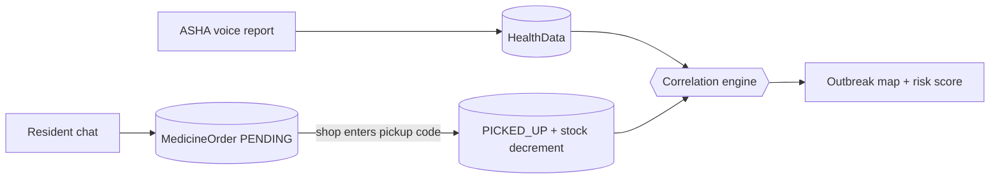

# JanSetu — Architecture & APIs

One Next.js app, one MongoDB. Three roles that write data, plus a public view that
needs no account.

---

## 1. The idea in one paragraph

An ASHA worker speaks a field report; NLP pulls out the disease and case count and the
map updates live. Separately, residents chat with a health assistant that suggests
medicine and books it at a local shop. When the shop confirms the pickup, stock drops
and that sale becomes evidence. Correlating the two independent streams — what ASHAs
report, and what medicine actually moved — gives a stronger outbreak signal than either
alone, and specifically catches **under-reporting**: areas where medicine is selling but
nobody has filed a report.



---

## 2. Roles

| Role | Signup | Approval | Home |
|------|--------|----------|------|
| **ASHA** | `/register/asha` | Admin — reports paint the map | `/workspace` |
| **MEDICAL** | `/register/medical` | Admin — stock feeds the signal | `/medical` |
| **USER** | `/register/user` | None — nothing they do moves a number alone | `/sehat` |
| **ADMIN** | env credentials | — | `/workspace` |
| *(public visitor)* | — | — | `/` — charts, map, no login |

`HOSPITAL` was removed. Some dead role branches remain inside
`app/api/health-data/route.js`; they are unreachable now that nothing can register as
one, and were left alone rather than risk a 2,600-line refactor.

---

## 3. Where things live

| Path | What it does |
|------|----------------|
| `app/page.js` | Public landing: charts, red-zone map, three registration cards |
| `app/components/public/` | Public dashboard + read-only risk map |
| `app/sehat/` | Resident chat (Sehat Sahayak) + order tracking |
| `app/medical/` | Shop dashboard: stock, pickup queue, confirm-by-code, demand chart |
| `app/workspace/` | ASHA/admin surveillance workspace (map, trends, reports) |
| `app/components/voice/quick-case-capture.jsx` | Voice report + live map marker |
| `app/lib/report-nlp.js` | Hindi/Hinglish/English → disease + case count |
| `app/lib/data/medicine-catalog.js` | **The medicine dataset** — 40 items with disease weights |
| `app/lib/ai/gemini.js` | Gemini chat + embeddings, degrades to null on failure |
| `app/lib/ai/medicine-retrieval.js` | Vector + lexical search over the catalog (the R in RAG) |
| `app/lib/ai/health-assistant.js` | Red flags, intent detection, system prompt, fallback replies |
| `app/lib/orders/order-timing.js` | Pure cooldown/expiry policy (no DB) |
| `app/lib/orders/cooldown.js` | Order guards against DB |
| `app/lib/correlation/medicine-signal.js` | Medicine sales → disease signal → correlation |
| `app/lib/outbreak-rules.js` | Risk scoring |
| `app/lib/chart-theme.js` | CVD-validated chart palette |
| `scripts/seed-medicines.mjs` | Seeds catalog + embeddings |
| `proxy.js` | Route guard: `/`, `/login`, `/register/*` public; rest needs a session |

---

## 4. API routes

| Route | Auth | Purpose |
|-------|------|---------|
| `GET /api/public/dashboard` | **none** | Aggregated charts + risk zones for the landing page |
| `GET /api/public/area-insight` | **none** | Area health guide by coordinates |
| `POST /api/chat` · `GET` | USER | Sehat Sahayak turn / history |
| `POST /api/orders` · `GET` | USER | Raise reservation / list own orders |
| `GET /api/medical/stock` · `PUT` | MEDICAL | Shelf view / restock |
| `GET /api/medical/orders` | MEDICAL | Pending pickup queue |
| `POST /api/medical/orders` | MEDICAL | **Confirm pickup by code — the only place stock moves** |
| `POST /api/predictions/outbreak` | ASHA/MEDICAL/ADMIN | Risk score + correlation for an area |
| `GET/POST /api/health-data` | ASHA/MEDICAL/ADMIN | Field reports + dashboard payload |
| `/api/asha/register`, `/api/medical/register`, `/api/user/register` | none | Signup |
| `/api/admin/*` | ADMIN | Approvals, ASHA creation |

---

## 5. Data model

| Collection | Holds |
|------------|-------|
| **User** | ADMIN / ASHA / MEDICAL / USER, location, approval status |
| **HealthData** | ASHA + medical field reports, `verification` correlation block |
| **Medicine** | The catalog: brand, salt, `diseaseSignals[]`, `schedule`, embedding |
| **MedicalStock** | One row per shop per medicine; unique on `(medical, sku)` |
| **MedicineOrder** | Reservations and confirmed pickups — also the sales ledger |
| **ChatSession** | Per-user conversation + rolling symptom history |

---

## 6. The medicine dataset

`app/lib/data/medicine-catalog.js` — 40 medicines (24 OTC, 16 RX), brand + salt
(`Dolo 650 (Paracetamol 650mg)`), plain-Hinglish descriptions, symptom phrases, and
the field that makes correlation possible:

```js
diseaseSignals: [{ disease: "DIARRHEA", weight: 0.75 }, { disease: "CHOLERA", weight: 0.6 }]
```

**Weights are deliberately uneven.** Paracetamol sells for everything, so it points
weakly at five different fevers (0.15–0.35). An ACT malaria kit is only dispensed on a
positive test, so it points at malaria at 0.9. A TB kit is 0.95. This is what stops
"paracetamol sales are up" from being read as "dengue outbreak".

Seed it with:

```bash
npm run seed:medicines     # safe to re-run; upserts by SKU
```

---

## 7. How the fake-spike guard works

The whole correlation rests on one assumption: **one sick person ≈ one course of
medicine.** Two behaviours break that, and each has a guard.

**1. Ordering in every chat turn.** While a `PENDING` order exists for a medicine, the
same user cannot raise another. Enforced in `checkOrderAllowed`.

**2. Re-ordering right after collecting.** At pickup the order is stamped with
`cooldownUntil`, derived from that medicine's own course length — 3 days for
Paracetamol, 14 for a zinc course — floored at 2 days and capped at 30.

**3. And the structural one:** ordering moves nothing. Stock only decrements when the
shop enters the 4-digit pickup code. A user typing "yes bought it" fifty times produces
fifty unclaimed reservations and zero change to any number the map reads. Unclaimed
orders expire after 48 hours.

Guards refuse the *order*, never the *advice* — the assistant still replies and still
gives care guidance when a cooldown fires.

---

## 8. The two chat paths

`detectIntent()` decides which path a message is on, and the path decides what may
even be offered:

| Path | Trigger | Allowed |
|------|---------|---------|
| `SELF_MEDICATION` | default | **OTC only.** Short course. Always names when to see a doctor. |
| `DOCTOR_PRESCRIBED` | "doctor ne", "parchi", "डॉक्टर ने", … | RX becomes reachable — but the assistant looks up what the doctor chose rather than choosing. |

The OTC restriction is enforced twice: the retrieval layer filters the catalog, and
`POST /api/orders` re-checks before creating anything. The UI is not the security
boundary.

**Red flags run first, before retrieval.** Chest pain, breathlessness, bleeding,
unconsciousness, week-long fever, pregnancy, newborns, severe dehydration — matched by
plain string comparison in Hindi, Hinglish and English. On a hit, no medicine is
retrieved or offered at all; the reply is "go to a PHC now, call 108". This is
deliberately *not* delegated to the LLM, because a missed emergency is the one failure
mode of this feature that actually harms someone.

---

## 9. Correlation output

Per disease, per area, `correlateSignals()` returns one of:

| Status | Meaning | Confidence |
|--------|---------|-----------|
| `CONFIRMED` | ASHA reports **and** medicine demand agree | 0.9 |
| `ASHA_ONLY` | Reports but no medicine movement — early, or over-reported | 0.5 |
| `MEDICINE_ONLY` | **Medicine selling, no reports — likely under-reporting** | 0.6 |

`MEDICINE_ONLY` is the interesting one: it surfaces outbreaks nobody has filed a report
about, and it becomes a "survey this area" recommendation in the prediction response.

Medicine evidence adds to the risk score but is **capped at 18 points**, so verified
pickups can strengthen a real cluster without manufacturing one on their own.

---

## 10. Gemini

Set `GEMINI_API_KEY` in `frontend/.env`, then re-run `npm run seed:medicines` so the
catalog gets embeddings.

Without the key everything still works:

| With key | Without key |
|----------|-------------|
| Natural Hinglish replies | Deterministic template replies |
| Vector + lexical medicine search | Lexical only |

Every safety rule — red flags, OTC gating, cooldowns — is rule-based and identical
either way. The LLM is an enhancement, never a dependency.

Retrieval computes cosine similarity in Node rather than using an Atlas vector index:
the catalog is 40 rows, so a full scan is sub-millisecond and an external vector
service would buy nothing. Past a few thousand rows, move to `$vectorSearch` — the call
sites do not change.

---

## 11. Environment

| Variable | Purpose |
|----------|---------|
| `MONGO_URI` | Mongo connection |
| `NEXTAUTH_URL` / `NEXTAUTH_SECRET` | Sessions |
| `ADMIN_USERNAME` / `ADMIN_PASSWORD` | Static admin login |
| `GEMINI_API_KEY` | Optional — chat + embeddings |
| `GEMINI_CHAT_MODEL` | Default `gemini-flash-lite-latest` |
| `GEMINI_EMBED_MODEL` | Default `gemini-embedding-001` (768 dims) |

Not every key has quota on every model. If chat replies silently fall back to the
deterministic path, list what the key can actually reach:

```bash
curl -s "https://generativelanguage.googleapis.com/v1beta/models?key=$GEMINI_API_KEY" \
  | grep -o '"name": "[^"]*"'
```

A `429` with `limit: 0` means the key has no free-tier quota for that model — pick a
different one from the list rather than waiting for a reset.

---

## 12. Running it

```bash
cd frontend
npm install
npm run seed:medicines     # catalog + embeddings; re-run after catalog edits
npm run seed:demo          # optional: a working demo scenario
npm run dev                # http://localhost:3000
```

`seed:demo` creates three `demo-` accounts (password `demo1234`) in Rampur, Varanasi:
an approved medical shop stocked with all 40 medicines, a resident, and an ASHA worker
with 14 days of reports where dengue climbs 1 → 17. It is idempotent.

| Account | Role |
|---------|------|
| `demo-user@jansetu.local` | resident → `/sehat` |
| `demo-medical@jansetu.local` | shop → `/medical` |
| `demo-asha@jansetu.local` (or `ASHA_900`) | worker → `/workspace` |

**Demo path that shows the whole idea:**

1. Open `/` logged out — charts and the red-zone map are already populated.
2. Log in as the resident, say *"mujhe 2 din se bukhar hai"* → OTC suggestions appear.
3. Book one → a 4-digit pickup code is issued; stock has **not** moved.
4. Ask for the same medicine again → refused, active-reservation cooldown.
5. Log in as the shop, enter the code → stock drops, the sale is counted.
6. Re-check `/api/predictions/outbreak` → that disease flips `ASHA_ONLY` → `CONFIRMED`.

Try *"seene me dard ho raha hai"* to see the red-flag path refuse to suggest anything,
and *"doctor ne typhoid ki dawai likhi hai"* to see RX items become reachable.
