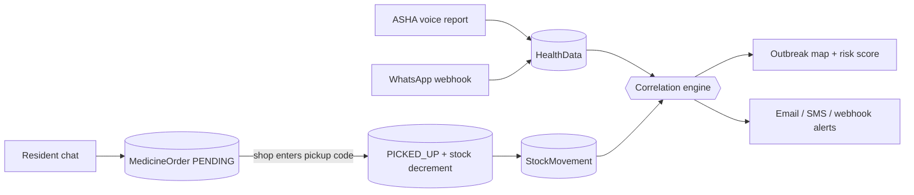

# JanSetu — Architecture & APIs

One Next.js app, one MongoDB. Three roles that write data, plus a public view that
needs no account. Every screen and every server message is written in English and
Hinglish at once.

---

## 1. The idea in one paragraph

An ASHA worker speaks a field report; NLP pulls out the disease and case count and the
map updates live. Separately, residents chat with a health assistant that suggests
medicine and books it at a nearby shop. When the shop confirms the pickup, stock drops,
a ledger row is written, and that sale becomes evidence. Correlating the two independent
streams — what ASHAs report, and what medicine actually moved — gives a stronger
outbreak signal than either alone, and specifically catches **under-reporting**: areas
where medicine is selling but nobody has filed a report.



---

## 2. Roles

| Role | Signup | Approval | Home |
|------|--------|----------|------|
| **ASHA** | `/register/asha` | Admin — reports paint the map | `/workspace` |
| **MEDICAL** | `/register/medical` | Admin — stock feeds the signal | `/medical` |
| **USER** | `/register/user` | None — nothing they do moves a number alone | `/sehat` |
| **ADMIN** | env credentials | — | `/workspace` |
| *(public visitor)* | — | — | `/` — charts, map, no login |

`app/lib/auth/role-home.js` is the single table that decides role homes, which paths a
role may open, and which sidebar links it sees. The proxy, the layouts and the login
form all read it, so a rendered link can never point at a page its own role is refused.

| Area | Open to |
|------|---------|
| `/workspace`, `/workspace/trends`, `/workspace/map` | ADMIN, ASHA, MEDICAL |
| `/workspace/insights` | ADMIN, ASHA, MEDICAL |
| `/workspace/reports` | ADMIN, ASHA — a shop filing survey counts would pollute the ASHA side of the very comparison it is checked against |
| `/workspace/team`, `/admin/*` | ADMIN |
| `/medical` | MEDICAL |
| `/sehat`, `/sehat/profile` | USER |

`HOSPITAL` was removed. Dead role branches remain inside `app/api/health-data/route.js`
(~2,700 lines); they are unreachable now that nothing can register as one, and were left
alone rather than risk a large refactor.

---

## 3. Where things live

| Path | What it does |
|------|----------------|
| `app/page.js` | Public landing: charts, red-zone map, three registration cards |
| `app/components/public/` | Public dashboard, read-only risk map, GPS area panel |
| `app/sehat/` | Resident chat (Sehat Sahayak) + order tracking |
| `app/sehat/profile/` | Longitudinal health record: episode timeline + generated report |
| `app/medical/` | Shop dashboard: stock, pickup queue, confirm-by-code, demand chart |
| `app/workspace/` | ASHA/admin surveillance workspace (overview, trends, map, reports, insights, team) |
| `app/components/voice/quick-case-capture.jsx` | Voice report + live map marker |
| `app/components/prescription/prescription-upload.jsx` | Prescription photo upload |
| `app/components/i18n/` | Language toggle + locale provider |
| `app/lib/report-nlp.js` | Hindi/Hinglish/English → disease + case count |
| `app/lib/i18n/locale.js` · `server.js` | `t("English", "Hinglish")` on client and server |
| `app/lib/data/medicine-catalog.js` | **The medicine dataset** — 40 items with disease weights |
| `app/lib/ai/gemini.js` | Chat, JSON, vision and embeddings; degrades to null on failure |
| `app/lib/ai/medicine-retrieval.js` | Vector + lexical search over the catalog (the R in RAG) |
| `app/lib/ai/health-assistant.js` | Red flags, intent detection, system prompt, fallback replies |
| `app/lib/ai/prescription-reader.js` | Reads a prescription photo; **rules** decide accept/reject |
| `app/lib/ai/health-profile.js` | Builds the longitudinal profile prompt from computed facts |
| `app/lib/chat/episodes.js` | Episode lifecycle — one bout of illness per record |
| `app/lib/orders/order-timing.js` | Pure cooldown/expiry policy (no DB) |
| `app/lib/orders/cooldown.js` | Order guards against DB |
| `app/lib/orders/shop-router.js` | Picks and ranks the shop that can fulfil an order |
| `app/lib/orders/stock-ledger.js` | Appends `StockMovement` rows; never throws |
| `app/lib/correlation/medicine-signal.js` | Medicine sales → disease signal → correlation |
| `app/lib/correlation/medicine-velocity.js` | How fast each medicine moves, weighted by specificity |
| `app/lib/correlation/area-reasoning.js` | Rule-built explanation of a correlated area |
| `app/lib/correlation/narrate.js` | Optional LLM rephrasing — forbidden from inventing numbers |
| `app/lib/correlation/validation.js` | Synthetic accuracy, agreement matrix, backtest |
| `app/lib/outbreak-rules.js` | Risk scoring |
| `app/lib/decision-engine.js` | Trend direction, moving averages, forecast helpers |
| `app/lib/public-area.js` | Joins the two public feeds into one verdict, client-side |
| `app/lib/chart-theme.js` | CVD-validated chart palette |
| `scripts/seed-medicines.mjs` | Seeds catalog + embeddings |
| `scripts/seed-demo.mjs` | Full demo scenario |
| `scripts/seed-medicine-history.mjs` · `stock-shop.mjs` | Backfill helpers, run with `node` directly |
| `proxy.js` | Route guard: `/`, `/login`, `/register/*` public; rest needs a session |

---

## 4. API routes

### Public — no session

| Route | Purpose |
|-------|---------|
| `GET /api/public/dashboard` | Aggregated charts + risk zones for the landing page |
| `GET /api/public/area-insight` | Area health guide by coordinates |
| `GET /api/location/search` | Village/district lookup (Nominatim) |
| `GET /api/location/janaushadhi` | Nearby pharmacies, Janaushadhi flagged (Overpass) |
| `GET/POST /api/ingest/whatsapp` | Webhook verify + field reports over WhatsApp, token-authed |
| `POST /api/asha/register` · `/api/medical/register` · `/api/user/register` | Signup |

### Resident (USER)

| Route | Purpose |
|-------|---------|
| `POST /api/chat` · `GET` · `DELETE` | Sehat Sahayak turn / current episode / close episode |
| `GET/DELETE /api/episodes/[id]` | One past episode's transcript, or delete it |
| `GET /api/profile` | Longitudinal health record; regenerated only when history moved |
| `POST /api/health-guide` | Personal health guide built from their own conversation |
| `POST /api/prescriptions` · `GET` | Upload a prescription photo for verification / list own |
| `GET /api/prescriptions/[id]/image` | The photo — served only to its owner and the fulfilling shop |
| `POST /api/orders` · `GET` | Raise reservation / list own orders |

### Shop (MEDICAL)

| Route | Purpose |
|-------|---------|
| `GET /api/medical/stock` · `PUT` | Shelf view / restock |
| `GET /api/medical/orders` | Pending pickup queue |
| `POST /api/medical/orders` | **Confirm pickup by code — the only place stock moves** |

### Surveillance

| Route | Auth | Purpose |
|-------|------|---------|
| `POST /api/predictions/outbreak` | ASHA/MEDICAL/ADMIN | Risk score, velocity and correlation for an area |
| `GET /api/insights/correlation` | ASHA/MEDICAL/ADMIN | Two-sided insight screen + engine validation |
| `GET/POST /api/health-data` | ASHA/MEDICAL/ADMIN | Field reports, dashboard payload, outbreak alerts |
| `GET /api/supply` · `POST` · `PATCH` | ADMIN/MEDICAL (PATCH admin-only) | Supply orders — **in-memory, not yet persisted** |
| `GET /api/supply/recommend` | ADMIN/MEDICAL | Routing suggestions from forecast demand |
| `GET/POST /api/notifications/audit` | ADMIN | Alert delivery log — **in-memory, capped at 10k** |
| `/api/admin/*` | ADMIN | Approvals, ASHA creation, pending users |

Non-admin callers are pinned to their own district by the route itself; only ADMIN
passes `canSeeAllAreas`.

---

## 5. Data model

| Collection | Holds |
|------------|-------|
| **User** | ADMIN / ASHA / MEDICAL / USER, location, approval status |
| **HealthData** | ASHA + medical field reports, `verification` correlation block |
| **Medicine** | The catalog: brand, salt, `diseaseSignals[]`, `schedule`, contraindications, embedding |
| **MedicalStock** | One row per shop per medicine; unique on `(medical, sku)` |
| **MedicineOrder** | Reservations and confirmed pickups — also the sales ledger |
| **StockMovement** | Append-only shelf ledger: `RESTOCK`, `PICKUP`, `COUNTER_SALE`, `CORRECTION` |
| **ChatSession** | One **episode** — a single complaint and the conversation about it |
| **HealthProfile** | Cached longitudinal report per resident, stamped with what it was built from |
| **Prescription** | Photographed prescription, what was read off it, and the SKUs it unlocks |

Two of those are recent and worth a note.

**ChatSession is now one record per episode**, not one rolling document per user. It
used to be truncated at 60 messages and wiped whenever someone started a new
conversation, which made the longitudinal profile impossible — "aapko 2 mahine me 3 baar
pet ki takleef hui" cannot be said when last month's conversation no longer exists.
Starting a new conversation now closes the current episode rather than erasing it, and
a conversation idle for 5 days is treated as finished.

**StockMovement** exists because `MedicineOrder` only records medicine that came through
the chatbot. Walk-in counter sales and restocks are movement too, and the correlation
engine reads the ledger so it sees the whole shelf, not just the app's slice of it.
Writing a ledger row deliberately never throws: it is evidence *about* a stock change,
not the change itself, so a failed row is logged rather than reported to the pharmacist
as a failed sale.

---

## 6. The medicine dataset

`app/lib/data/medicine-catalog.js` — 40 medicines (24 OTC, 16 RX), brand + salt
(`Dolo 650 (Paracetamol 650mg)`), plain-Hinglish descriptions, symptom phrases,
contraindications (Ibuprofen during dengue), and the field that makes correlation
possible:

```js
diseaseSignals: [{ disease: "DIARRHEA", weight: 0.75 }, { disease: "CHOLERA", weight: 0.6 }]
```

**Weights are deliberately uneven.** Paracetamol sells for everything, so it points
weakly at five different fevers (0.15–0.35). An ACT malaria kit is only dispensed on a
positive test, so it points at malaria at 0.9. A TB kit is 0.95. This is what stops
"paracetamol sales are up" from being read as "dengue outbreak".

Seed it with:

```bash
npm run seed:medicines     # safe to re-run; upserts by SKU
```

---

## 7. How the fake-spike guard works

The whole correlation rests on one assumption: **one sick person ≈ one course of
medicine.** Two behaviours break that, and each has a guard.

**1. Ordering in every chat turn.** While a `PENDING` order exists for a medicine, the
same user cannot raise another. Enforced in `checkOrderAllowed`.

**2. Re-ordering right after collecting.** At pickup the order is stamped with
`cooldownUntil`, derived from that medicine's own course length — 3 days for
Paracetamol, 14 for a zinc course — floored at 2 days and capped at 30.

**3. And the structural one:** ordering moves nothing. Stock only decrements when the
shop enters the 4-digit pickup code. A user typing "yes bought it" fifty times produces
fifty unclaimed reservations and zero change to any number the map reads. Unclaimed
orders expire after 48 hours.

Guards refuse the *order*, never the *advice* — the assistant still replies and still
gives care guidance when a cooldown fires.

Orders are routed to a real shop by `pickMedicalShop`: own village first, then whatever
is measurably closest within **15 km**, then the rest of the district. That radius is
small on purpose — someone walks or takes a share-auto to collect medicine — and it
doubles as the blast radius of the outbreak signal, since every pickup inside it is
evidence about roughly one locality.

---

## 8. The two chat paths

`detectIntent()` decides which path a message is on, and the path decides what may
even be offered:

| Path | Trigger | Allowed |
|------|---------|---------|
| `SELF_MEDICATION` | default | **OTC only.** Short course. Always names when to see a doctor. |
| `DOCTOR_PRESCRIBED` | "doctor ne", "parchi", "डॉक्टर ने", … | RX becomes *discussable* — the assistant looks up what the doctor chose rather than choosing |

The OTC restriction is enforced twice: the retrieval layer filters the catalog, and
`POST /api/orders` re-checks before creating anything. The UI is not the security
boundary.

**Saying "doctor ne bola" no longer unlocks anything.** It once did, and that was not a
gate at all — anyone who typed the phrase got antibiotics. An RX order now requires a
`Prescription` record that is `VERIFIED`, still inside its validity window, and whose
`unlockedSkus` names that exact medicine. The paper has to exist, be readable, be
recent, and list the drug.

The prescription flow splits responsibility deliberately. The model only *reads* — it
reports what it can see on the photograph, and is told to return an empty string rather
than guess a doctor's name or complete a half-visible medicine name. Every accept/reject
decision is then made by rules in code: a plain date comparison against a **30-day**
validity window, a minimum read confidence, and a catalog match on the written lines.
A model asked "is this valid?" will agree with a confident-looking user; a model asked
"what is the date on this paper?" will just tell you.

**Red flags run first, before retrieval.** Chest pain, breathlessness, bleeding,
unconsciousness, week-long fever, pregnancy, newborns, severe dehydration — matched by
plain string comparison in Hindi, Hinglish and English. On a hit, no medicine is
retrieved or offered at all; the reply is "go to a PHC now, call 108". This is
deliberately *not* delegated to the LLM, because a missed emergency is the one failure
mode of this feature that actually harms someone.

---

## 9. Correlation output

Per disease, per area, `correlateSignals()` returns one of:

| Status | Meaning |
|--------|---------|
| `CONFIRMED` | ASHA reports **and** medicine demand agree |
| `ASHA_ONLY` | Reports but no medicine movement — early, or over-reported |
| `MEDICINE_ONLY` | **Medicine selling, no reports — likely under-reporting** |

`MEDICINE_ONLY` is the interesting one: it surfaces outbreaks nobody has filed a report
about, and it becomes a "survey this area" recommendation in the prediction response.

Confidence is computed rather than fixed per status — from how many independent sources
saw it, how much total evidence there is, and whether the two sides agree or one is
carrying the whole signal. It lands between 0.1 and 0.95.

Medicine evidence adds to the risk score but is **capped at 18 points**, so verified
pickups can strengthen a real cluster without manufacturing one on their own.

### Velocity, and why specificity is weighted everywhere

`medicine-velocity.js` builds the chain under the headline number:

```
kitni tez biki  ->  wo dawai kis liye hai  ->  kis bimari ka ishara  ->  kitna risk
```

Paracetamol doubling means almost nothing — it is given for every fever there is. A
papaya-leaf extract doubling means dengue, because nobody buys it for anything else. A
risk model that treats those two jumps alike sends health workers chasing flu seasons,
so specificity is weighted in the score, in the ranking, and in the sentence the admin
reads. Above 0.7 a medicine is treated as near-diagnostic; below 0.4 it is
broad-spectrum and discounted.

### Explaining it, and checking it

`area-reasoning.js` turns a correlated area into an explanation an admin can act on —
entirely by rule, never generated. `narrate.js` may then rephrase those sentences in
friendlier Hinglish, but it is handed the finished analysis as its only source and is
forbidden from introducing a number that is not already there; the caller keeps the
deterministic text if the model is unavailable or the output looks wrong. A dashboard
that tells a district officer to send a survey team has to be able to show its working
three weeks later, and a sentence produced by a language model cannot be audited.

`validation.js` answers "does the engine actually work?" and keeps three things
separate, because there is no ground truth here — ASHA reports and medicine movement are
two noisy observers of the same reality, and neither is the truth:

| Measure | What it is |
|---------|------------|
| **Synthetic accuracy** | Labelled scenarios with a known answer, run through the real engine. A genuine confusion matrix — it tests whether the rules behave as designed, not whether the world matches the scenarios. |
| **Agreement matrix** | How often the two real sources agree, on real data, reported with Cohen's kappa. This is agreement, **not** accuracy: a disagreement is the output the system exists to produce, not a false positive. |
| **Backtest** | The only true accuracy measure — predict today, check against what was reported two days later. Returns `INSUFFICIENT_DATA` with the shortfall spelled out rather than a number computed from four points. |

Scoring the engine against ASHA reports would be worse than useless: its headline
feature is finding the cases ASHAs *missed*, so treating their reports as truth would
count every real under-reporting catch as a false positive.

---

## 10. Outbreak alerts

When `/api/health-data` scores an area past the alert threshold it dispatches on up to
four channels — Resend email, SMTP email, Twilio SMS, and a signed webhook. Each is
optional and silently skipped when unconfigured. Deliveries are deduplicated inside a
20-minute window per `(outbreak, channel, recipient)` and retried on a 1 / 5 / 15 minute
backoff.

`GET /api/notifications/audit` (ADMIN) shows the delivery log. Both that log and
`/api/supply`'s order store are **in-memory** — they reset on restart and do not survive
a serverless cold start. Moving them to MongoDB is the obvious next step.

---

## 11. Language

Every user-facing string travels as a pair, written together at the point of use:

```js
t("Live map", "Live map")
t("visible reports", "dikhne wale reports")
```

A key-based dictionary is the usual choice and for a dozen locales it would be the right
one. At two it buys nothing and costs plenty: several hundred keys to invent, a second
file to keep in step, and a missing-key failure mode that shows a raw identifier to a
villager. The same helper shape works on the server (`serverTranslator(request)`), so an
API message and the button that triggered it are written the same way.

English is the default; Hinglish is a choice the reader makes. The selection rides in
the `jansetu_locale` cookie so server-rendered strings match the client.

---

## 12. Gemini

Set `GEMINI_API_KEY` in `frontend/.env`, then re-run `npm run seed:medicines` so the
catalog gets embeddings.

Without the key everything still works:

| With key | Without key |
|----------|-------------|
| Natural Hinglish replies | Deterministic template replies |
| Vector + lexical medicine search | Lexical only |
| Prescription photos read automatically | Upload rejected — no RX unlock |
| Narrated area explanations | Rule-built text, which was always complete |
| Generated longitudinal profile | Episode timeline without the report |

Every safety rule — red flags, OTC gating, prescription validity, cooldowns — is
rule-based and identical either way. The LLM is an enhancement, never a dependency, with
one honest exception: prescription reading needs vision, so RX unlocking is unavailable
without a key rather than degraded.

Retrieval computes cosine similarity in Node rather than using an Atlas vector index:
the catalog is 40 rows, so a full scan is sub-millisecond and an external vector
service would buy nothing. Past a few thousand rows, move to `$vectorSearch` — the call
sites do not change.

---

## 13. Environment

**Required**

| Variable | Purpose |
|----------|---------|
| `MONGO_URI` | Mongo connection |
| `NEXTAUTH_URL` / `NEXTAUTH_SECRET` | Sessions (`AUTH_SECRET` also accepted) |
| `ADMIN_USERNAME` / `ADMIN_PASSWORD` | Static admin login |

**Optional**

| Variable | Purpose |
|----------|---------|
| `GEMINI_API_KEY` | Chat, prescriptions, embeddings, narration |
| `GEMINI_CHAT_MODEL` | Default `gemini-flash-lite-latest` |
| `GEMINI_EMBED_MODEL` | Default `gemini-embedding-001` (768 dims) |
| `NEXT_PUBLIC_MAPBOX_TOKEN` | Map tiles; falls back to OSM |
| `WHATSAPP_VERIFY_TOKEN` / `WHATSAPP_WEBHOOK_TOKEN` | WhatsApp ingest handshake + auth |
| `OUTBREAK_ALERT_EMAIL_TO` + `RESEND_API_KEY` | Email alerts via Resend |
| `SMTP_HOST` / `SMTP_PORT` / `SMTP_USER` / `SMTP_PASS` / `SMTP_FROM` | Email alerts via SMTP |
| `OUTBREAK_SMS_TO` + `TWILIO_ACCOUNT_SID` / `TWILIO_AUTH_TOKEN` / `TWILIO_FROM_NUMBER` | SMS alerts |
| `OUTBREAK_WEBHOOK_URL` / `OUTBREAK_WEBHOOK_TOKEN` | Webhook alerts |

Not every key has quota on every model. If chat replies silently fall back to the
deterministic path, list what the key can actually reach:

```bash
curl -s "https://generativelanguage.googleapis.com/v1beta/models?key=$GEMINI_API_KEY" \
  | grep -o '"name": "[^"]*"'
```

A `429` with `limit: 0` means the key has no free-tier quota for that model — pick a
different one from the list rather than waiting for a reset.

---

## 14. Running it

```bash
cd frontend
npm install
npm run seed:medicines     # catalog + embeddings; re-run after catalog edits
npm run seed:demo          # optional: a working demo scenario
npm run dev                # http://localhost:3000
```

`seed:demo` creates three `demo-` accounts (password `demo1234`) in Rampur, Varanasi:
an approved medical shop stocked with all 40 medicines, a resident, and an ASHA worker
with 14 days of reports where dengue climbs 1 → 17. It is idempotent.

| Account | Role |
|---------|------|
| `demo-user@jansetu.local` | resident → `/sehat` |
| `demo-medical@jansetu.local` | shop → `/medical` |
| `demo-asha@jansetu.local` (or `ASHA_900`) | worker → `/workspace` |

**Demo path that shows the whole idea:**

1. Open `/` logged out — charts and the red-zone map are already populated.
2. Log in as the resident, say *"mujhe 2 din se bukhar hai"* → OTC suggestions appear.
3. Book one → a 4-digit pickup code is issued; stock has **not** moved.
4. Ask for the same medicine again → refused, active-reservation cooldown.
5. Log in as the shop, enter the code → stock drops, a ledger row is written.
6. Re-check `/api/predictions/outbreak` → that disease flips `ASHA_ONLY` → `CONFIRMED`.
7. Open `/workspace/insights` → the same call, explained, with the engine's own
   validation numbers underneath it.

Try *"seene me dard ho raha hai"* to see the red-flag path refuse to suggest anything,
and *"doctor ne typhoid ki dawai likhi hai"* to see the assistant discuss RX items but
still refuse to book one until a prescription photo is uploaded and verified.
